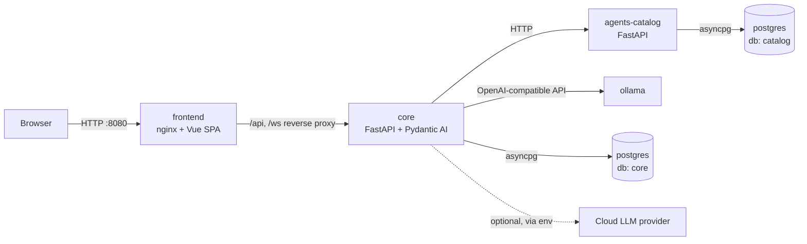

# Virtual Office — Technology Stack

| Field             | Value                                                                 |
| ----------------- | --------------------------------------------------------------------- |
| Status            | Proposed (pending acceptance of [ADR-0002](adr/0002-technology-stack.md)) |
| Versions verified | 2026-10-16, against npm, PyPI, Docker Hub, nodejs.org, endoflife.date, ollama.com |
| Related           | [CONSTITUTION.md](CONSTITUTION.md) Article XV, [PRINCIPLES.md](PRINCIPLES.md); tool guides: [BACKEND.md](BACKEND.md), [FRONTEND.md](FRONTEND.md), [DESIGN.md](DESIGN.md), [DOCKER.md](DOCKER.md), [OLLAMA.md](OLLAMA.md), [POSTGRES.md](POSTGRES.md) |

This document is the single source of truth for **what** we build Virtual Office with and
**which exact versions**. The Constitution defines the architecture rules; this file defines the
tools. Changing anything here requires a repository ADR.

---

## 1. Version policy (non-negotiable)

1. **Latest stable only.** Every framework, library, runtime and image starts at the latest
   **stable** release available on the day it is added. Pre-releases (`alpha`, `beta`, `rc`,
   `dev`, `next`, `canary`) are forbidden.
2. **Never obsolete.** A dependency is obsolete when it is deprecated, archived, unmaintained
   (no release in 18 months **and** open security issues), past end-of-life, or replaced by an
   official successor. Obsolete dependencies MUST be replaced.
3. **Never `latest`.** The word `latest` (Docker tags, npm dist-tags, Ollama model tags, GitHub
   Actions refs) MUST NOT appear in any file of this repository. The same applies to floating
   tags like `stable`, `lts`, `mainline` or major-only tags (`node:24`, `postgres:18`).
4. **Exact pins.**
   - Docker images: full version tag **plus** digest (`postgres:18.6-trixie@sha256:…`). The
     digest is added when the Dockerfile/compose file is created.
   - npm: exact versions in `package.json` (no `^`, no `~`), `pnpm-lock.yaml` committed,
     `save-exact=true` in `.npmrc`.
   - Python: exact `==` pins in `pyproject.toml` for direct dependencies, `uv.lock` committed.
   - Ollama models: explicit size/quantization tag (`qwen3.6:27b`), never bare names.
5. **Compatibility beats novelty, explicitly.** When the newest release of a tool is
   incompatible with another pinned tool, we pin the newest **compatible** release and record
   the blocker in §9 "Known version holds". Holds are re-checked at every dependency update.
6. **Updates are continuous.** Renovate opens update PRs weekly; a PR is merged only when the
   full quality gate is green. Security updates are merged within 48 hours.
7. **Minimal dependencies.** Before adding a dependency, prefer the platform/standard library.
   Every new direct dependency is justified in the PR description.

---

## 2. Runtime topology — everything is dockerized

Every service runs in a container. Nothing is installed on the host except Docker (Engine and
Compose minimum versions in [DOCKER.md](DOCKER.md) §1). The whole system starts with one command:

```bash
docker compose up --build
```



| Service          | Responsibility                                                                                     | Image (base)                                   | Port (internal) | Exposed on host |
| ---------------- | -------------------------------------------------------------------------------------------------- | ---------------------------------------------- | --------------- | --------------- |
| `frontend`       | Serves the My Workbench SPA (static build) and reverse-proxies `/api` and `/ws` to `core`           | `nginxinc/nginx-unprivileged:1.31.7-alpine3.24` (runtime), `node:24.22.0-trixie-slim` (build) | 8080 | `127.0.0.1:8080` |
| `core`           | Domain, application, Orchestrator, agent runtime (Pydantic AI), REST + WebSocket API, event store   | `python:3.15.0-slim-trixie`                    | 8000            | no              |
| `agents-catalog` | Registry of agent definitions: roles, versioned prompts, toolsets, output schemas, model assignments, character catalog, eval sets | `python:3.15.0-slim-trixie` | 8001 | no |
| `ollama`         | Local LLM inference server                                                                          | `ollama/ollama:0.40.5`                         | 11434           | no              |
| `postgres`       | Persistence: one cluster, one database per service (`core`, `catalog`)                             | `postgres:18.6-trixie`                         | 5432            | no (dev profile: `127.0.0.1:5432`) |

### 2.1 Service ownership rules

- **Database per service.** `core` owns database `core`; `agents-catalog` owns database
  `catalog`. A service MUST NOT read or write another service's database. Each has its own DB
  role with least privileges (no superuser at runtime).
- **`core` is the only writer of domain state** (events, projections). The Constitution's
  domain rules live here.
- **`agents-catalog` is read-mostly.** `core` fetches role definitions by version
  (`GET /roles/{role}/versions/{v}`), caches them in memory with ETag revalidation, and records
  the resolved version in every agent job event. Catalog content is seeded from versioned files
  in `services/agents-catalog/catalog/` (prompts as Markdown, definitions as YAML validated by
  Pydantic) — files are the source, the database is the served/indexed copy.
- **`ollama` is stateless except for its model volume.** Models are pulled by a one-shot
  `ollama-init` job (same image) that pulls the model tags locked (tag + digest) in
  `infra/ollama/models.lock` (see [OLLAMA.md](OLLAMA.md)).
- **`frontend` holds no secrets** and talks only to `core` through the same origin.

### 2.2 Compose layout

```
compose.yaml              # production-like base (Compose Specification, no `version:` key)
compose.dev.yaml          # dev overlay: bind mounts / `develop.watch`, exposed DB port, debug logs
compose.gpu.yaml          # optional overlay: GPU reservation for ollama
.env.example              # every variable documented, no secrets
```

Mandatory in `compose.yaml`:

- `healthcheck` for every service; `depends_on` with `condition: service_healthy`
  (`core` waits for `postgres`, `agents-catalog`, `ollama`);
- named volumes `pgdata`, `ollama-models`; no host bind mounts in the base file;
- non-root users in every image (`USER` set in Dockerfiles); read-only root filesystem where
  possible (`read_only: true` + `tmpfs` for `/tmp`);
- resource limits (`deploy.resources.limits`) for `core`, `agents-catalog`, `frontend`;
- one internal network `office`; only `frontend` publishes a port, bound to `127.0.0.1`;
- one-shot jobs: `migrate-core`, `migrate-catalog` (Alembic upgrade), `ollama-init`
  (model pull), run before the long-running services start.

### 2.3 Dockerfile rules

- Multi-stage builds; final stage contains only runtime artifacts.
- Python images: build stage uses `uv` from `ghcr.io/astral-sh/uv:0.13.1` (copied binary),
  `uv sync --frozen --no-dev`; runtime stage copies the virtualenv; `PYTHONDONTWRITEBYTECODE=1`,
  `PYTHONUNBUFFERED=1`; served by `uvicorn` with `--proxy-headers`.
- Frontend: build stage `pnpm install --frozen-lockfile && pnpm build`; runtime nginx serves
  `dist/` with immutable cache headers for hashed assets and `no-cache` for `index.html`.
- `.dockerignore` in every service context.
- Images scanned (Trivy) in CI; build fails on HIGH/CRITICAL with an available fix.

---

## 3. Frontend (`frontend/`)

TypeScript + Vue 3 + Vite, SPA, Composition API with `<script setup lang="ts">` only.

| Concern                | Choice                    | Version  | Notes |
| ---------------------- | ------------------------- | -------- | ----- |
| Build-time runtime     | Node.js LTS "Krypton"     | 24.22.0  | Used only inside the build container. Node 26 is "Current", not LTS yet. |
| Package manager        | pnpm                      | 12.14.0  | Pinned via `packageManager` field + Corepack |
| Language               | TypeScript                | 6.0.3    | Hold: 7.0.2 exists, see §9 |
| Framework              | Vue                       | 3.5.44   | |
| Build tool             | Vite                      | 8.3.4    | |
| Vue plugin             | @vitejs/plugin-vue        | 6.0.10   | |
| Router                 | vue-router                | 5.4.0    | |
| State                  | Pinia                     | 4.1.0    | Stores fed by the WebSocket event stream |
| Composables            | @vueuse/core              | 15.0.0   | Window drag/resize, keyboard, reduced-motion detection |
| API types              | openapi-typescript        | 7.13.0   | Generates TS types from `core`'s OpenAPI schema (contract source = Pydantic models) |
| API client             | openapi-fetch             | 0.17.0   | Typed `fetch` wrapper over the generated types |
| **Office renderer**    | **pixi.js**               | 8.22.0   | See §4 |
| Tilemap                | @pixi/tilemap             | 5.0.2    | Batched tile rendering for the office map |
| Type-check SFCs        | vue-tsc                   | 3.3.13   | |
| Unit/component tests   | Vitest + @vitest/coverage-v8 | 5.0.5 | |
| Component test utils   | @vue/test-utils           | 2.5.1    | |
| DOM env for tests      | jsdom                     | 30.1.3   | |
| Property tests         | fast-check                | 4.10.2   | Pathfinding, choreography queue invariants |
| E2E + visual regression| @playwright/test          | 1.64.1   | Runs against the full compose stack |
| Lint                   | eslint                    | 10.13.0  | Flat config |
| Lint (Vue)             | eslint-plugin-vue         | 10.11.1  | |
| Lint (TS)              | typescript-eslint         | 8.71.2   | |
| Lint (Vue + TS preset) | @vue/eslint-config-typescript | 14.9.0 | |
| Module boundaries      | eslint-plugin-boundaries  | 7.2.0    | FRONTEND.md §1.1 |
| Accessibility checks   | @axe-core/playwright      | 4.14.0   | Zero violations per window |
| Format                 | prettier                  | 3.9.10   | |

**No UI component library.** The Amiga Workbench look (windows, gadgets, requesters, menus,
icons) is a hand-built Vue component kit in `frontend/src/ui-amiga/` (Constitution §14.4).
Third-party component libraries would fight the pixel-perfect rules.

**No runtime schema library on the client.** Contracts are validated on the server (Pydantic);
the client consumes generated types. Contract drift is caught in CI by regenerating types and
failing on diff.

---

## 4. Decision: graphics library for Amiga 500 look and smooth character movement

### 4.1 Decision

**PixiJS 8.22.0** (WebGL/WebGPU 2D renderer) with **@pixi/tilemap 5.0.2** (no audio library: Constitution §14.10), wrapped in a single
Vue component (`OfficeCanvas.vue`) that owns the `Application` instance, plus an **in-house
office engine** (`frontend/src/office-engine/`, plain TypeScript, no Vue imports) for the
game loop, pathfinding and choreographies.

The DOM-based Workbench UI (windows, board, chat) stays in Vue components — **only** the
Office View is a canvas.

### 4.2 Why PixiJS

| Criterion                         | PixiJS 8.22.0                                            | Phaser 4.2.1                                         | Hand-written Canvas 2D             |
| --------------------------------- | -------------------------------------------------------- | ---------------------------------------------------- | ---------------------------------- |
| Fit with "scene is a projection" (Constitution P5) | Renderer only; we own state and loop → clean projection | Full game framework with its own scenes, loop, state — competes with Pinia/events | Full control |
| Integration with Vue              | One component mounts the canvas; no framework clash      | Phaser `Game` lifecycle must be bridged to Vue        | Trivial                             |
| Pixel-art rendering               | `roundPixels`, `scaleMode: 'nearest'`, integer resolution | Equivalent (`pixelArt: true`)                       | Manual                              |
| Performance (7+ sprites, tilemap, particles) | GPU batching, WebGPU/WebGL, tilemap plugin  | GPU, comparable                                       | CPU-bound, risky at 4× scale        |
| Bundle size                       | Tree-shakeable, renderer only                            | Larger (physics, input, scenes we don't need)        | Zero                                |
| Testability                       | Engine logic is plain TS, renderer is a thin adapter      | Logic tends to live inside Phaser scenes             | Good                                |

Phaser is an excellent engine, but we would use ~20 % of it and fight its scene/state model.
Canvas 2D would mean reinventing batching, texture atlases and a ticker. PixiJS is the
smallest tool that gives GPU rendering with pixel-perfect control.

### 4.3 How "smooth like a video game" is achieved without losing the Amiga look

1. **Fixed-timestep simulation at 50 Hz ("PAL time")** in the office engine, driven by an
   accumulator on the PixiJS `Ticker`; rendering runs at the display refresh rate (60/120 Hz).
2. **Render interpolation**: the renderer draws each sprite at
   `lerp(previousPosition, currentPosition, alpha)` where `alpha` is the accumulator fraction,
   so motion is smooth at any refresh rate while the simulation stays deterministic.
3. **Sub-pixel simulation, pixel-snapped output**: positions are floats in logical pixels;
   the final drawn position is rounded to the logical pixel grid (`roundPixels: true`), and the
   whole stage is scaled by an **integer** factor with nearest-neighbour filtering. Result:
   smooth constant-speed glides with crisp, authentic pixels — no blurry half-pixels.
4. **Distance-driven walk cycles**: the walk animation frame advances by distance travelled
   (one frame every 4 logical pixels), not by time, so feet never slide at ×2/×4 speed.
5. **Constant-velocity movement along A\* paths with corner smoothing limited to the grid**
   (4-direction moves; direction change happens on tile centres) — reads as classic 16-bit
   top-down games.
6. **Y-sorting** with a `zIndex = feetY` per sprite and `sortableChildren` on the actors layer.
7. **Object pools** for speech bubbles, emotes, carried cards and particles: zero per-frame
   allocations in the hot path.
8. **Texture atlas** (one indexed-palette PNG + JSON) per sprite set → single draw batch.
9. **Optional CRT layer** (Preferences, off by default): a scanline overlay and slight
   phosphor bloom as a PixiJS filter, applied after integer upscale; disabled under
   reduced motion.
10. **Reduced motion**: the engine switches to instant placement with a 1-frame fade
    (Constitution §14.9).

### 4.4 Pixel assets toolchain

- Sprites and tiles authored in **Aseprite** (sources in `assets/src/`), exported as indexed PNG
  + JSON atlas; maps authored in **Tiled** (JSON export).
- A CI script validates every PNG palette entry against the OCS 12-bit rule
  (Constitution §14.1).
- Font: an openly licensed Topaz-style bitmap font, self-hosted as WOFF2, license recorded in
  `assets/LICENSES.md` and a dedicated ADR before use.

---

## 5. Backend services (`services/core`, `services/agents-catalog`)

Python + FastAPI + Pydantic AI. Both services share tooling and conventions; they are separate
`uv` workspace members.

| Concern                 | Choice                       | Version   | Notes |
| ----------------------- | ---------------------------- | --------- | ----- |
| Runtime                 | CPython                      | 3.15.0    | Released 2026-10-09; native wheels verified for `pydantic-core`, `asyncpg`, `uvloop`, `httptools` |
| Package/env manager     | uv                           | 0.13.1    | `uv.lock` committed; `uv sync --frozen` in Docker |
| Web framework           | FastAPI                      | 0.143.3   | REST + WebSocket; OpenAPI is the contract source |
| ASGI server             | uvicorn                      | 0.54.0    | With `uvloop` + `httptools` |
| Validation / models     | Pydantic                     | 2.14.1    | DTOs, event payloads, settings, catalog definitions |
| Settings                | pydantic-settings            | 2.16.0    | 12-factor config from environment |
| **Agent framework**     | **pydantic-ai-slim**         | 2.57.0    | With extras `[openai]` (Ollama via OpenAI-compatible API) and optionally `[anthropic]`; slim avoids unused providers |
| ORM / SQL toolkit       | SQLAlchemy (async)           | 2.1.4     | Core for event store, ORM for projections |
| PostgreSQL driver       | asyncpg                      | 0.32.0    | |
| Migrations              | Alembic                      | 1.20.0    | One migration history per service |
| IDs                     | python-ulid                  | 4.0.1     | |
| Logging                 | structlog                    | 26.1.0    | JSON logs to stdout, correlation IDs |
| Tracing / metrics       | opentelemetry-sdk            | 1.45.1    | OTLP export optional via env |
| HTTP client             | httpx                        | 0.28.1    | `core` → `agents-catalog`; also test client |
| Tests                   | pytest                       | 9.1.1     | |
| Async tests             | anyio (pytest plugin)        | 4.15.1    | Single async test plugin (no pytest-asyncio) |
| Property tests          | hypothesis                   | 6.170.1   | Kanban invariants (Constitution E17) |
| Agent evals             | pydantic-evals               | 2.57.0    | Role evaluation datasets (OLLAMA.md §5) |
| Coverage                | pytest-cov                   | 7.1.0     | Thresholds per Constitution §18.2 |
| Test data               | polyfactory                  | 3.3.0     | Factories for Pydantic models |
| Integration DB          | testcontainers               | 4.15.0    | Real `postgres:18.6-trixie` in tests |
| HTTP mocking            | respx                        | 0.23.1    | Mock `agents-catalog` / LLM HTTP in tests |
| Lint + format           | ruff                         | 0.17.1    | Replaces flake8/isort/black |
| Type checking           | mypy (strict, pydantic plugin) | 2.4.0   | `ty` is still 0.0.x → not adopted yet |
| Architecture boundaries | import-linter                | 2.15      | Enforces the dependency rule |

### 5.1 `core` internal layout (DDD / hexagonal)

```
services/core/src/virtual_office/
├── domain/            # Aggregates, value objects, domain events, domain services — pure Python, no I/O
│   ├── kanban/        # Project, Card, workflow state machine, WIP rules
│   ├── staff/         # Office, Agent, personas
│   ├── intake/        # Note, triage
│   └── decisions/     # Project ADRs
├── application/       # Commands, queries, handlers, Orchestrator, ports (Protocols)
├── agents/            # Pydantic AI agents per role, tools, output models, context packs
├── infrastructure/    # Postgres event store, projections, catalog client, LLM providers, git workspace
└── api/               # FastAPI routers, WebSocket gateway, DTO mapping
```

Dependency rule (import-linter contract): `domain` ← `application` ← `agents` ←
`infrastructure` / `api`. `domain` imports only the standard library and Pydantic.

### 5.2 Agents with Pydantic AI

- One `Agent` per role, constructed from the catalog definition (instructions, tools, output
  type, model), with `output_type` = a Pydantic model (structured output is mandatory).
- Tools are registered per role exactly as the Constitution §15.7 toolset; tool functions call
  **application commands/queries**, never repositories directly.
- Dependencies are injected through Pydantic AI `deps` (a typed dataclass with the ports the
  role may use) → least privilege by construction.
- Tests use Pydantic AI's `TestModel` / `FunctionModel` — no network, deterministic
  (Constitution §16.9). The `FakeLlmAdapter` of the Constitution is implemented this way.
- Usage (tokens, requests) from each run is recorded in the job events.

### 5.3 `agents-catalog` responsibilities

- Serves versioned role definitions: `role`, `version`, `instructions` (Markdown), `tools`
  (names from an allow-list known by `core`), `output_schema` reference, `default_model`,
  `competence_tags`.
- Serves the **Character Catalog** (face IDs, names of archetypes, asset paths).
- Serves eval sets per role.
- Exposes `GET` endpoints for `core` and an admin import endpoint used by its seed job; no
  user-facing UI in v1.
- Definitions are immutable once published (new version instead).

---

## 6. LLM inference

| Item                    | Choice |
| ----------------------- | ------ |
| Default provider        | **Ollama 0.40.5** (local, in compose) via Pydantic AI's OpenAI-compatible provider pointed at `http://ollama:11434/v1` |
| Optional provider       | Anthropic (Pydantic AI `[anthropic]` extra), enabled only when `ANTHROPIC_API_KEY` is set; chosen per role in Preferences |
| Default models (pinned tags) | PM, Architect, QA: `qwen3.6:27b` · Developers: `qwen3.6:27b-coding` · Designer, Support: `gemma4:12b` |
| Model pinning           | Exact tags + digests in `infra/ollama/models.lock`; bare names or `latest` are rejected by settings validation |
| Hardware                | CPU works but is slow; `compose.gpu.yaml` reserves an NVIDIA GPU. On macOS, Docker cannot use the Apple GPU: the documented alternative is setting `VO_OLLAMA_BASE_URL` to a host-installed Ollama — the container remains the default |

Model choices are configuration, not code (Constitution Article XVI) and are re-evaluated with
the role eval sets whenever a model tag changes.

---

## 7. Data

| Item            | Choice |
| --------------- | ------ |
| Engine          | PostgreSQL **18.6** |
| Databases       | `core` (event store + projections + agent runs), `catalog` |
| Event store     | Append-only table `events` (`event_id` ULID PK, `aggregate_type`, `aggregate_id`, `aggregate_version`, `type`, `version`, `occurred_at timestamptz`, `actor jsonb`, `payload jsonb`, `meta jsonb`, `correlation_id`, `causation_id`), unique `(aggregate_type, aggregate_id, aggregate_version)` for optimistic concurrency; `UPDATE`/`DELETE` revoked for the runtime role |
| Projections     | Regular tables updated in the same transaction as the append (v1) |
| Realtime fan-out| After commit, `core` pushes to WebSocket clients; `LISTEN/NOTIFY` reserved for future multi-instance `core` |
| Backups         | `pg_dump` one-shot service in `compose.yaml` profile `backup` |

---

## 8. CI/CD and tooling

| Item               | Choice |
| ------------------ | ------ |
| CI                 | GitHub Actions; every action pinned by **commit SHA** (with version comment) |
| Pipeline           | lint → type-check → unit → build images → integration (testcontainers) → compose up → Playwright E2E + visual regression → Trivy scan |
| Dependency updates | Renovate (weekly, grouped by ecosystem; digests pinned) |
| Pre-commit         | `pre-commit` hooks running ruff, mypy, eslint, prettier, `vue-tsc`, and a `no-latest` check |
| `no-latest` check  | CI scans every manifest, lockfile, Dockerfile, compose file, workflow and `.env.example` for `:latest`, `@latest`, `"latest"` and floating image tags; any hit fails the build (Markdown docs that describe the rule are excluded) |

---

## 9. Known version holds

| Tool        | Newest   | Pinned | Reason                                                                 | Re-check |
| ----------- | -------- | ------ | ---------------------------------------------------------------------- | -------- |
| TypeScript  | 7.0.2    | 6.0.3  | `typescript-eslint` 8.71.2 declares peer `typescript >=4.8.4 <6.1.0`   | Every Renovate run; lift as soon as typescript-eslint supports 7.x |
| Node.js     | 26.12.0 (Current) | 24.22.0 (LTS) | Policy: runtimes use the latest **LTS** line, "Current" lines are not stable for builds | When 26 enters LTS |

---

## 10. Repository layout

```
virtual-office/
├── AGENTS.md
├── compose.yaml · compose.dev.yaml · compose.gpu.yaml · .env.example · renovate.json
├── .docs/                        # Constitution, Stack, Principles, ADRs
├── .agents/skills/               # Contributor skills
├── frontend/                     # Vue + Vite SPA, ui-amiga kit, office-engine, Dockerfile, nginx.conf
├── services/
│   ├── core/                     # FastAPI + Pydantic AI, Dockerfile, alembic/
│   └── agents-catalog/           # FastAPI, catalog/ (prompts, role YAML, characters), Dockerfile, alembic/
├── pyproject.toml · uv.lock      # uv workspace root (members: services/*)
├── assets/                       # Sprites, tiles, maps, fonts (+ LICENSES.md, src/)
└── e2e/                          # Playwright tests against the compose stack
```
